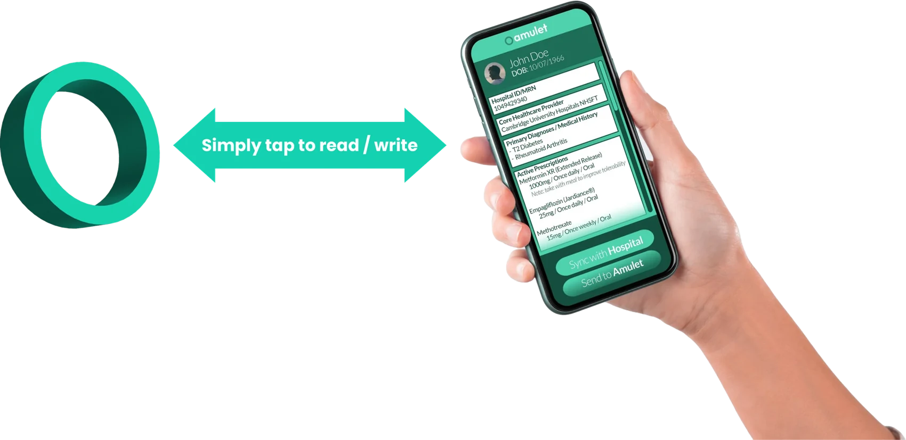

# Amulet: Wearable EHRs

- short: Amulet
- summary: A health record you wear as a ring, bracelet or keyfob. Tap it with any phone to read or write, with no network needed
- status: current
- from:
- until:
- project:
- url: https://amulet.health

## The problem

A third of the world's data is health data, yet less than 5% of it is used to improve outcomes. Health systems are fragmented, so records sit in silos. Patients and providers have no single reliable source of truth, even though access to your own records is a basic patient right. Only 61% of patients in high-resource OECD countries can access their electronic health record.

The gap is wider elsewhere. 43% of the world's population lives rurally, 1.5% is forcibly displaced at any time, and 2.6 billion people are offline. Only 78% of people over ten own even a basic feature phone.

Two people show what this looks like in practice.

- **Joyce** is a sales manager in Glasgow with records from Uganda, the US and the UK. None of them are joined up, so she repeats investigations and history taking at every provider she meets.
- **Alex** is a painter-decorator in London who has grown up with allergies, asthma and eczema. He uses wearables and health apps, but has no secure, portable way to combine his NHS record with the data he generates himself.

## What Amulet is

Amulet is a decentralised wearable electronic health record. You tap it against a phone to read or write.

- **Ultra-low cost.**
- **Offline first.** No network is needed.
- **Works on any modern phone.**
- **Private and interoperable.** It uses the FHIR and HL7 standards.
- **Owned by the patient.** You decide who sees your data.
- **Your choice of form.** Ring, necklace, bracelet or keyfob.

It holds the vital information in one place: diagnoses, medications, allergies, vaccines, investigations and results, imaging, your primary clinician, insurance, physiological data, genomics and past clinical interactions.

Amulet is one part of a wider, resilient ecosystem: at-home diagnostics such as blood pressure monitors and glucometers, pharmacies, public and private providers, third-sector medical providers and community health workers. The aim is care that is personalised, preventative, predictive and participatory, wherever you are in the world.

## Why a wearable

We looked at the obvious alternatives first.

- **A smartphone app?** 47% of people (3.7 billion) do not own a smartphone, and 25% (1.9 billion) have no phone at all.
- **Store it in the cloud?** 43% of the world does not yet use mobile internet, and 4% has no coverage. Concerns over the privacy of cloud-held data are also growing.
- **Use biometrics?** In some settings and populations, biometrics may be seen as punitive.

So we started from the bottom: a design for the people health systems reach least.

## What we have done so far

Amulet is a University of Cambridge spinout, supported by Cambridge Enterprise.

- Semi-finalists in the Cambridge Postdoc Venture Creation Challenge
- Members of the Centre for Global Equality Inclusive Innovation Cultivator
- A past project of the Cambridge Development i-Teams programme
- Proof-of-concept funding awards from former HP scientists and the Centre for Global Equality
- A network of clinical academics in the UK and overseas, across maternal and child health, neurosurgery and neurology, infectious diseases and public health

Through i-Teams and the Cultivator we held 30 international stakeholder interviews. They included the Rwandan Ministry of Health, Cambridge University Hospitals, Médecins Sans Frontières, Cambridge Global Health Partnerships, the Royal College of Paediatrics and Child Health, the Philips Foundation, Johns Hopkins and SHOFCO. Some of what we heard:

> There is a big interest in patient ownership of their health in many settings, particularly where there is no digital form of their health data.

> This may reduce clinical risk from fragmented records, such as prescription errors.

> There is real value with Amulet in fragmented systems. It addresses the issues of poor data availability and care continuity.

## The team

Amulet was founded by Brandon Smith, a postdoc in global health engineering with an NIHR-funded PhD on SMS-based patient follow-up for developing settings. He teaches on the MSt in Healthcare Innovation and is Technology Lead at Cambridge Public Health.

## Sources

1. Johns Hopkins Center for Global Digital Health Innovation. World Bank report: Digital-in-Health.
2. Patients' access to medical records around the world. The BMJ.
3. OECD. Health at a Glance 2023.
4. World Bank Group datasets. Rural population.
5. UNHCR. Global Trends.
6. ITU. Facts and Figures 2023/2024.
7. GSMA. The State of Mobile Internet Connectivity 2024.
8. Digital technologies: tensions in privacy and data. Journal of the Academy of Marketing Science, 2022.
9. Biometrics and public health surveillance in criminalised and key populations: policy, ethics, and human rights considerations. The Lancet HIV, 2018.
