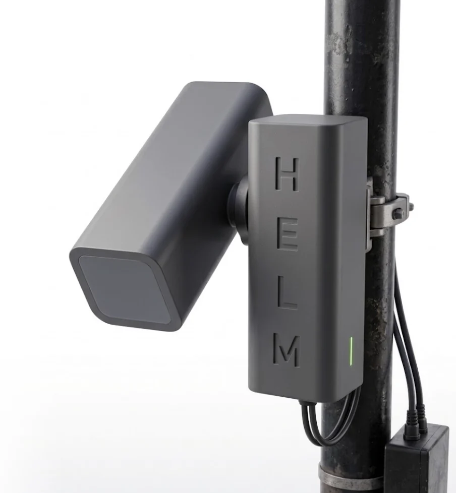

# HELM: Protective Equipment Monitoring

- short: HELM
- summary: A low-cost camera unit that counts helmet and high-visibility clothing use among e-scooter and cycle riders, without sending any images
- status: current
- from:
- until:
- project:
- url:

## Why we built it

Head injuries are common and often preventable. Traumatic brain injury affects an estimated 69 million people worldwide each year, and about a million people attend an emergency department in the UK with a head injury annually.

Micromobility is a newer part of that picture. E-scooters were involved in 484 serious injuries and 10 deaths in Great Britain in 2025. Injured e-scooter riders sustain brain injuries more often than cyclists or motorcyclists, yet only 5.9% are recorded as wearing a helmet. Wearing one is associated with about half the odds of a head injury.

Nobody measures this routinely. Hospital records are an unreliable stand-in: at Cambridge University Hospitals, helmet use was written down for only 38% of cycling-related major trauma admissions. Where it was, 34% of helmet wearers had a head injury, against 82% of those without. Without that data, injury prevention can be neither targeted nor evaluated.

## What we have built

HELM is a small unit that watches a stretch of street and counts how many riders wear a helmet or high-visibility clothing. It is built to sit on an ordinary lamp post or pole.

- **The picture stays on the device.** All the processing happens inside the unit, and only anonymous counts leave it.
- **No cables or mobile signal.** It is designed to run on solar power and report over a low-power radio mesh, so it does not depend on mains electricity or a cellular network.
- **More than helmets.** It also detects high-visibility clothing and other protective equipment.
- **Built to be compared with hospital data.** The counts are designed to sit alongside head injury presentations at a regional Major Trauma Centre.

No data is shared with the police or used to identify individuals.

## Where we have got to

Seed funding from the School of Technology at the University of Cambridge let us develop a helmet detection model that scores 0.92 on the standard `mAP@0.5` accuracy measure and runs in real time on a low-cost single-board computer with an AI accelerator. Earlier studies of helmet use analysed recorded video or street-level imagery after the fact. HELM runs live, on the street, on hardware cheap enough to put in many places.

Cambridge is a good place to do this. Nearly half of adults here cycle weekly, and rental e-scooter use is rising.

## The team

Tom Bashford and Brandon Smith lead the work with Sara Venturini, Mia Lin and Peter Hutchinson.

## Sources

1. Dewan MC, et al. Estimating the global incidence of traumatic brain injury. J Neurosurg 2019;130(4):1080–97.
2. National Institute for Health and Care Research. Highlight notice: traumatic brain injury. 2026.
3. Department for Transport. Reported road casualties Great Britain: e-scooter factsheet, 2025. 2026.
4. Kungwengwe G, et al. E-scooter riders sustain more head and internal injuries than motorcyclists and cyclists in England and Wales. Sci Rep 2026;16:23470.
5. Olivier J, Creighton P. Bicycle injuries and helmet use: a systematic review and meta-analysis. Int J Epidemiol 2017;46(1):278–92.
6. Arshad Z, et al. Cycling-related trauma admissions to the major trauma centre in the cycling capital of the United Kingdom. Injury 2022;53:3970–7.
7. Department for Transport. Walking and cycling statistics, England: 2023. Local area walking and cycling rates (Active Lives Survey).
8. Cambridgeshire and Peterborough Combined Authority. E-scooter trial update. Transport Committee report, 17 November 2025.
